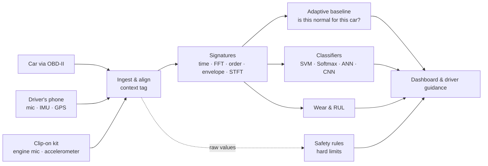

# AutoPulse

**Your car's heartbeat, read by the sensors it already has.**

AutoPulse extracts signatures from engine sound, vibration and OBD-II telemetry, recognises faults with SVM, Softmax regression, ANN and CNN models, learns what is normal for each car, and tells the driver what to do. Built for the Honeywell problem statement *Automobile engine data: signature extraction and pattern recognition*.

📄 **[Round 1 concept report (PDF)](report/AutoPulse-Concept-Report.pdf)** · 🧭 **[Step-by-step walkthrough](docs/WALKTHROUGH.md)** · 🗺️ [Research & plan](PROJECT_PLAN.md) · 🔌 [OBD-II primer](docs/OBD2_EXPLAINED.md)

## Results so far

| Test | Data | Result |
|---|---|---|
| Fault classification from engine sound | 321 **real** recordings, held out by recording | **90.3%** (SVM); 91.0% per recording |
| Bearing fault classification | **Real** CWRU vibration, unseen motor load | 100% (known easy benchmark) |
| Adaptive baseline on real driving | 129 **real** carOBD trips, held-out test trips | False alarms on **14%** of healthy trips vs 31% for a fixed baseline; 91% of vacuum leaks caught |
| Misfire detection on an independent simulator | **MATLAB** crankshaft dynamics, 84 runs | **100%** detected; misfiring cylinder named **100%** at 800–3,500 rpm |
| Misfire detection on **MathWorks' Simulink engine** | Powertrain Blockset misfire example, detector run blind | **11 / 11** misfires detected, 2 false alarms in 71 healthy strokes |
| DSP cross-check | **All 28** features recomputed in **MATLAB** | Agree to 6 × 10⁻¹⁴ (filters to ~0.002%) |
| Adaptive vs fixed baseline over 8 months | Simulated car, summer → winter | 0 vs 74 false-alarm days; real fault caught in 3 days |

Simulator-only scores (SVM 98.3% on held-out simulated engines) are treated as upper bounds; the real-data rows are the numbers that count. Details and caveats: [walkthrough step 6](docs/WALKTHROUGH.md#6--real-data-traintest-evaluate_realpy).

## Quick start

Double-click **`run.bat`** (Windows). It checks Python and Node, creates `.venv`, installs dependencies only when they change, trains the models if they are missing, starts the API and the UI, and opens **http://localhost:5173**. Ctrl+C stops both.

Manual equivalent:

```bash
python -m venv .venv
.venv\Scripts\python -m pip install -r requirements.txt --extra-index-url https://download.pytorch.org/whl/cpu
.venv\Scripts\python -m uvicorn backend.app:app --port 8000
cd frontend && npm install && npm run dev
```

The original Streamlit dashboard still works as a fallback: `.venv\Scripts\python -m streamlit run app.py`. Real-data evaluation and MATLAB cross-checks: see the [walkthrough](docs/WALKTHROUGH.md).

## The app

| Screen | What it shows |
|---|---|
| **Garage** | Pick a car (hatchback, sedan, SUV, pickup, coupe). A see-through wireframe model built in Blender, its health score, and what needs attention |
| **Health check** | Animated key-on scan. Click a check and the car turns to that part; the panel explains which sensors it read |
| **Live drive** | OBD-II telemetry with a scrubber, one chart at a time, and the safety rules' guidance when a limit trips |
| **Signatures** | Waveform, spectrum, spectrogram, envelope, orders and crank speed for the chosen fault; all four models' votes; compare car types |
| **Live audio** | Your computer's microphone through the real-engine-audio model: waveform, level, spectrogram, measurements, model scores and recent history, with quality and engine-likeness gates (see below) |
| **Insights** | Adaptive vs fixed baseline over 8 months; component wear like phone battery health |
| **Evidence** | Real-data, MATLAB and Simulink, and simulator results |

## How it works



## Repository map

| Path | What it is |
|---|---|
| `autopulse/generator.py` | Physics-inspired engine vibration generator: 7 conditions, 10 simulated cars |
| `autopulse/signatures.py` | 28 signature features + STFT spectrogram |
| `autopulse/models.py` | SVM, Softmax regression, ANN, CNN |
| `autopulse/baseline.py` | Adaptive per-car, per-context baseline; wear trends |
| `autopulse/rules.py` | Hard safety limits with driver guidance |
| `autopulse/telemetry.py` | 1 Hz OBD-II drive simulator with injectable faults |
| `autopulse/realdata.py` | Loaders for the real public datasets |
| `train.py` | Train on simulated engines, test on held-out engines |
| `train_live_audio.py` | Train the Live audio model on real engine recordings → `models/live_audio.joblib` |
| `autopulse/live_audio.py` | Live microphone preprocessing, quality and novelty gates, inference |
| `frontend/src/live/` | Browser microphone capture (AudioWorklet), ring buffer, analysis scheduler |
| `tests/` | pytest suite (`pip install -r requirements-dev.txt`); frontend tests: `npm test` in `frontend/` |
| `evaluate_real.py` | Train and test on real recordings |
| `matlab/` | MATLAB crankshaft simulation, MathWorks Simulink misfire example runner, DSP re-implementation |
| `scripts/download_data.py` | Fetch the free public datasets (no login) |
| `scripts/matlab_crosscheck.py` | Use the MATLAB outputs in the Python pipeline |
| `scripts/checks/` | Developer sanity checks |
| `run.bat` | One-click launcher: dependencies, models, API + UI |
| `backend/app.py` | FastAPI: the same simulators, models, baseline and rules as JSON |
| `frontend/` | React (Vite) app: Garage, Health check, Live drive, Signatures, Insights, Evidence; 3D cars with three.js |
| `blender/build_cars.py` | Procedural car models (Blender): lofted body, glass, lights, wheels, wireframe contour lines, named health zones; `blender/out/*.blend` to open and edit |
| `app.py`, `autopulse/ui_car3d.py` | Original Streamlit dashboard (fallback) |
| `report/` | Concept report source (HTML/CSS → PDF) and figures |
| `models/` | Trained models and every results file (`metrics.json`, `real_metrics.json`, `matlab_crosscheck.json`) |

## Live Audio Monitoring (microphone)

The **Live audio** page captures your computer's microphone in the browser and analyses it with a model trained on real engine recordings.

**Read this first.** A laptop microphone hearing your voice, music, a fan or room noise is not engine audio. Nothing on this page is a validated vehicle diagnosis. The model has not been validated on any microphone, room or car outside its training dataset. Running inference is not the same as validating it.

**Setup (once):**

```bash
.venv\Scripts\python scripts\download_data.py engine_audio   # ~350 MB, Hugging Face RashmiKarunarathne/MyDataSet (licence not stated on the card)
.venv\Scripts\python train_live_audio.py                      # ~2 min; writes models/live_audio.joblib + live_audio_metrics.json
```

Without `models/live_audio.joblib` the page still captures and shows the waveform, spectrogram and measurements. It says that no compatible model is available and makes no predictions. The simulator-trained `svm/softmax/ann.joblib` are deliberately **not** used: on real engine sound they score 15–41% (`real_metrics.json → audio.zero_shot_from_simulator`).

**Use:** start the app (`run.bat`), open **http://localhost:5173**, go to **Live audio**, press **Start microphone** and allow access. Microphones only work on `localhost` or HTTPS. If you denied access by mistake, re-allow it from the site settings in the address bar. **Stop microphone** releases the device; so does leaving the page.

**Pipeline:**

1. The browser captures audio with echo cancellation, noise suppression and auto-gain off. An AudioWorklet mixes it to mono into a 4 s ring buffer.
2. Every hop (0.5 / 1 / 2 s, selectable), the last 1 s is POSTed as raw float32 to `/api/live-audio/analyze?sample_rate=…`. Only one request is in flight; windows that would overlap are skipped.
3. The backend runs the same chain as `evaluate_real.py`'s audio suite: mono → `resample_poly` to 24 kHz → z-score → `estimate_rpm` → `signatures.features` (28 features) → SVM.
   - Difference 1: a stream has no "recording" to normalise over, so each window is z-scored on its own. The saved model is trained the same way. Grouped-CV accuracy is unchanged (90.5% per window, 91.3% per recording, vs 90.4% with per-recording normalisation).
   - Difference 2: as a consequence, `log_rms` is pinned to 0 (see `live_audio.featurize`).
4. Labels are shown only if the window passes both gates:
   - **quality:** not silent; RMS above −50 dBFS; no more than 0.1% of samples clipped.
   - **engine-likeness:** an IsolationForest on the training features; its threshold rejects ~2% of held-out real engine windows. In testing it rejected 100% of synthetic voice-like, tone, chord and fan probes, but passed **30% of white-noise windows**. Broadband noise can still get a label.
5. Audio is analysed in memory and never stored or logged. Requests are limited to 4 s and 8–192 kHz; at most 2 run at once (extra requests get 429), with a 5 s timeout (504).

**Troubleshooting:**

| Symptom | Fix |
|---|---|
| "needs a secure page" | Use `http://localhost:5173`, not a LAN IP over http |
| "permission was denied" | Address-bar site settings → Microphone → Allow, then Start again |
| "No microphone was found" / "in use" | Check the system input device; close other apps holding it |
| Always "Unusable audio · quiet" | Raise the input level in the OS sound settings |
| "Cannot reach the AutoPulse API" | The backend on port 8000 is not running |
| "compatible trained model is unavailable" | Run the two setup commands above |

## Demo script (about 4 minutes)

1. **Garage:** flip through the five car types. Open **Scenario**, set *Misfire* and *Tyre puncture*; the score drops and the engine and tyre glow through the wireframe.
2. **Health check:** *Run again* for the animated scan; click *Engine sound & vibration* and the car turns to the engine.
3. **Signatures:** Knock → Spectrum (the knock band), Envelope (switch to Bearing for the BPFO peak), Crank speed (Misfire dips). Compare car types.
4. **Live drive:** *Coolant leak* → Play → "AC off, heater max, minutes to critical"; then *Alternator* and *Puncture*.
5. **Insights → Evidence:** the adaptive baseline story, then real-data, MATLAB and Simulink numbers.

## Data

Public datasets are downloaded by `scripts/download_data.py` into `data/raw/` and are not committed. Thanks to the authors of carOBD, the CWRU Bearing Data Center, and the Hugging Face engine-audio and engine-condition datasets.
