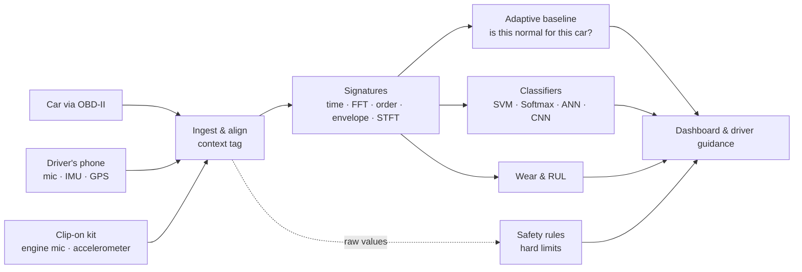

# AutoPulse

**Your car's heartbeat, read by the sensors it already has.**

AutoPulse extracts signatures from engine sound, vibration and OBD-II telemetry, recognises faults with SVM, Softmax regression, ANN and CNN models, learns what is normal for each car, and tells the driver what to do. Built for the Honeywell problem statement *Automobile engine data: signature extraction and pattern recognition*.

📄 **[Round 1 concept report (PDF)](report/AutoPulse-Concept-Report.pdf)** · 🧭 **[Step-by-step walkthrough](docs/WALKTHROUGH.md)** · 🗺️ [Research & plan](PROJECT_PLAN.md) · 🔌 [OBD-II primer](docs/OBD2_EXPLAINED.md)

## Results so far

| Test | Data | Result |
|---|---|---|
| Fault classification from engine sound | 321 **real** recordings, held out by recording | **90.3%** (SVM); 91.0% per recording |
| Bearing fault classification | **Real** CWRU vibration, unseen motor load | 100% (known easy benchmark) |
| Adaptive baseline on real driving | 129 **real** carOBD trips, held-out test trips | False alarms on **14%** of healthy trips vs 31% for a fixed baseline; 91% of vacuum leaks caught |
| Misfire detection on an independent simulator | **MATLAB** crankshaft dynamics, 84 runs | **100%** detected; misfiring cylinder named **100%** at 800–3,500 rpm |
| Misfire detection on **MathWorks' Simulink engine** | Powertrain Blockset misfire example, detector run blind | **11 / 11** misfires detected, 2 false alarms in 71 healthy strokes |
| DSP cross-check | **All 28** features recomputed in **MATLAB** | Agree to 6 × 10⁻¹⁴ (filters to ~0.002%) |
| Adaptive vs fixed baseline over 8 months | Simulated car, summer → winter | 0 vs 74 false-alarm days; real fault caught in 3 days |

Simulator-only scores (SVM 98.3% on held-out simulated engines) are treated as upper bounds; the real-data rows are the numbers that count. Details and caveats: [walkthrough step 6](docs/WALKTHROUGH.md#6--real-data-traintest-evaluate_realpy).

## Quick start

Double-click **`run.bat`** (Windows). It checks Python and Node, creates `.venv`, installs dependencies only when they change, trains the models if they are missing, starts the API and the UI, and opens **http://localhost:5173**. Ctrl+C stops both.

Manual equivalent:

```bash
python -m venv .venv
.venv\Scripts\python -m pip install -r requirements.txt --extra-index-url https://download.pytorch.org/whl/cpu
.venv\Scripts\python -m uvicorn backend.app:app --port 8000
cd frontend && npm install && npm run dev
```

The original Streamlit dashboard still works as a fallback: `.venv\Scripts\python -m streamlit run app.py`. Real-data evaluation and MATLAB cross-checks: see the [walkthrough](docs/WALKTHROUGH.md).

## The app

| Screen | What it shows |
|---|---|
| **Garage** | Pick a car (hatchback, sedan, SUV, pickup, coupe). A see-through wireframe model built in Blender, its health score, and what needs attention |
| **Health check** | Animated key-on scan. Click a check and the car turns to that part; the panel explains which sensors it read |
| **Live drive** | OBD-II telemetry with a scrubber, one chart at a time, and the safety rules' guidance when a limit trips |
| **Signatures** | Waveform, spectrum, spectrogram, envelope, orders and crank speed for the chosen fault; all four models' votes; compare car types |
| **Insights** | Adaptive vs fixed baseline over 8 months; component wear like phone battery health |
| **Evidence** | Real-data, MATLAB and Simulink, and simulator results |

## How it works



## Vibration analysis (simulated live accelerometer, or a recorded CSV)

Start AutoPulse as usual (`run.bat`) and open **Insights -> Vibration analysis** (third tab beside Adaptive baseline and Component wear). It has two modes:

**Live simulation (default)** - no file needed. Pick a fault, severity, RPM, condition (warm/cold), sampling frequency (2-24 kHz), simulation speed and rolling window, then **Start / Pause / Resume / Stop / Reset**. A WebSocket (`/api/vibration/live`, `autopulse/vibstream.py`) streams X/Y/Z samples in 0.25 s batches and a fresh analysis of the rolling window every 0.5 s: scrolling waveform, FFT, STFT spectrogram, RMS / peak-to-peak / crest factor / skewness / kurtosis, spectral peaks and band energy, and engine orders (RPM is known in simulation). Fault, severity, RPM, condition and speed can be changed mid-run; sampling rate, window and seed need a reset.

- **This is simulated.** `autopulse/vibsim.py` takes the engine simulator's block-vibration signal (`generator.synth_window`, the same signal the classifiers were trained on) and derives three axes from it: fixed seeded gains (X 1.0, Y ~0.55, Z ~0.8), independent sensor noise (3% of RMS), +1 g gravity on Z. Units are g by assumption. Successive 1 s blocks are cross-faded (20 ms) so they are continuous in amplitude but not phase-coherent. The source is made at 24 kHz and anti-alias resampled to the chosen rate (below ~12 kHz the 4-8 kHz knock/valve/squeal content cannot be represented). RPM is constant between settings changes. Same seed = same samples. None of this is a measurement of a real engine.
- **Memory is bounded:** the server keeps only the rolling window (<= 10 s); the browser keeps the last window of decimated display points. Features and spectra use every sample in the window.
- **Injected fault vs prediction:** the fault you select is the ground truth of the demo and is shown separately from the model's prediction. The prediction comes from the existing SVM/Softmax/ANN(/CNN) ensemble run on the simulator's native 24 kHz source window (the domain it was trained on), so it works on simulated data only and says nothing about real engines. If no classifier loads, the DSP still runs and classification shows as unavailable/error.
- **Split edition** (`split/`): the tab has three modes: **Paired vehicle** (the default), **Recorded CSV** and **Live simulation**. Paired vehicle runs the identical rolling analysis on the 1 s, 24 kHz vibration windows the paired vehicle laptop streams (`autopulse/wire.py`); windows are appended in order with no gaps, and the vehicle sends no ground truth. Live simulation is this simulator, run by the dashboard API with no vehicle or file needed. See [split/docs/SETUP.md](split/docs/SETUP.md#insights--vibration-analysis). After changing shared vibration files, run `python scripts/sync_split.py` to copy them into `split/`.
- **Limits:** one run per browser tab; stopping, resetting, or closing the tab cancels the server-side task.

**Recorded CSV** - the second mode analyses a recorded accelerometer file (`POST /api/vibration/analyze`, `autopulse/vibration.py`).

- **Columns:** optional `timestamp` (also `time`, `t`, `time_s`, `seconds`; seconds unless you pick ms/us) and `accel_x/y/z` (aliases `acc_x`, `ax`, `accelerometer_x`, `a_x`). Any other column can be analysed only if you tick it explicitly.
- **Sampling rate:** derived from timestamps if present; otherwise you must enter it. A supplied value that differs >2% from the timestamps is rejected, not overridden. Irregular timestamps (>1% of intervals off by >10%), duplicates, NaN/inf/non-numeric cells, <256 samples, >2 M samples or >25 MB are rejected with a specific error; nothing is dropped or interpolated.
- **Units:** `g`, `m/s2` or unknown. No conversion is applied.
- **Processing:** DC removal (default), optional linear detrend, high/low-pass (Butterworth, zero-phase). FFT: Hann window, amplitude-corrected single-sided spectrum, resolution = fs/N. STFT: Hann, 1024 samples, 50% overlap, dB. Multi-axis files also get a vector-magnitude channel. Envelope spectrum and engine orders are optional.
- **Classification of CSV recordings:** `available`, `unavailable` or `error`. **No accelerometer-recording classifier is shipped**, so it reports `unavailable` (the existing models need 24 kHz simulated windows and an RPM). A compatible one is picked up if `models/vibration_classifier.joblib` + `.json` (name, classes, feature_names like `accel_x.rms`, optional sampling_rate_hz, domain, limitations) exist.
- **Sample:** `data/samples/synthetic_accel_3axis.csv` (regenerate: `python scripts/make_vibration_sample.py`) is **synthetic**.
- **Not tested with physical sensors.** Neither mode is a live hardware connection.

**Tests:** `.venv\Scripts\python -m pytest tests -q` (backend), `cd frontend && npm test` (stream state logic, plain Node), and for split `cd split && ..\.venv\Scripts\python -m pytest tests -q`. There are no browser/component tests.

## Repository map

| Path | What it is |
|---|---|
| `autopulse/generator.py` | Physics-inspired engine vibration generator: 7 conditions, 10 simulated cars |
| `autopulse/signatures.py` | 28 signature features + STFT spectrogram |
| `autopulse/models.py` | SVM, Softmax regression, ANN, CNN |
| `autopulse/baseline.py` | Adaptive per-car, per-context baseline; wear trends |
| `autopulse/rules.py` | Hard safety limits with driver guidance |
| `autopulse/telemetry.py` | 1 Hz OBD-II drive simulator with injectable faults |
| `autopulse/realdata.py` | Loaders for the real public datasets |
| `train.py` | Train on simulated engines, test on held-out engines |
| `evaluate_real.py` | Train and test on real recordings |
| `matlab/` | MATLAB crankshaft simulation, MathWorks Simulink misfire example runner, DSP re-implementation |
| `scripts/download_data.py` | Fetch the free public datasets (no login) |
| `scripts/matlab_crosscheck.py` | Use the MATLAB outputs in the Python pipeline |
| `scripts/checks/` | Developer sanity checks |
| `run.bat` | One-click launcher: dependencies, models, API + UI |
| `backend/app.py` | FastAPI: the same simulators, models, baseline and rules as JSON |
| `frontend/` | React (Vite) app: Garage, Health check, Live drive, Signatures, Insights, Evidence; 3D cars with three.js |
| `blender/build_cars.py` | Procedural car models (Blender): lofted body, glass, lights, wheels, wireframe contour lines, named health zones; `blender/out/*.blend` to open and edit |
| `app.py`, `autopulse/ui_car3d.py` | Original Streamlit dashboard (fallback) |
| `report/` | Concept report source (HTML/CSS → PDF) and figures |
| `models/` | Trained models and every results file (`metrics.json`, `real_metrics.json`, `matlab_crosscheck.json`) |

## Demo script (about 4 minutes)

1. **Garage:** flip through the five car types. Open **Scenario**, set *Misfire* and *Tyre puncture*; the score drops and the engine and tyre glow through the wireframe.
2. **Health check:** *Run again* for the animated scan; click *Engine sound & vibration* and the car turns to the engine.
3. **Signatures:** Knock → Spectrum (the knock band), Envelope (switch to Bearing for the BPFO peak), Crank speed (Misfire dips). Compare car types.
4. **Live drive:** *Coolant leak* → Play → "AC off, heater max, minutes to critical"; then *Alternator* and *Puncture*.
5. **Insights → Evidence:** the adaptive baseline story, then real-data, MATLAB and Simulink numbers.

## Data

Public datasets are downloaded by `scripts/download_data.py` into `data/raw/` and are not committed. Thanks to the authors of carOBD, the CWRU Bearing Data Center, and the Hugging Face engine-audio and engine-condition datasets.
