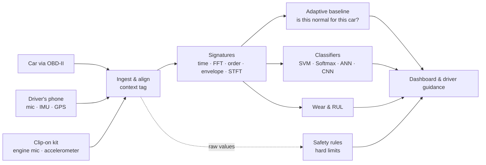

# AutoPulse

**Your car's heartbeat, read by the sensors it already has.**

AutoPulse extracts signatures from engine sound, vibration and OBD-II telemetry, recognises faults with SVM, Softmax regression, ANN and CNN models, learns what is normal for each car, and tells the driver what to do. Built for the Honeywell problem statement *Automobile engine data: signature extraction and pattern recognition*.

📄 **[Round 1 concept report (PDF)](report/AutoPulse-Concept-Report.pdf)** · 🧭 **[Step-by-step walkthrough](docs/WALKTHROUGH.md)** · 🗺️ [Research & plan](PROJECT_PLAN.md) · 🔌 [OBD-II primer](docs/OBD2_EXPLAINED.md)

## Results so far

| Test | Data | Result |
|---|---|---|
| Fault classification from engine sound | 321 **real** recordings, held out by recording | **90.3%** (SVM); 91.0% per recording |
| Bearing fault classification | **Real** CWRU vibration, unseen motor load | 100% (known easy benchmark) |
| Adaptive baseline on real driving | 129 **real** carOBD trips, held-out test trips | False alarms on **14%** of healthy trips vs 31% for a fixed baseline; 91% of vacuum leaks caught |
| Misfire detection on an independent simulator | **MATLAB** crankshaft dynamics, 84 runs | **100%** detected; misfiring cylinder named **100%** at 800–3,500 rpm |
| DSP cross-check | Same features recomputed in **MATLAB** on real audio | Agree to 6 × 10⁻¹⁴ |
| Adaptive vs fixed baseline over 8 months | Simulated car, summer → winter | 0 vs 74 false-alarm days; real fault caught in 3 days |

Simulator-only scores (SVM 98.3% on held-out simulated engines) are treated as upper bounds; the real-data rows are the numbers that count. Details and caveats: [walkthrough step 6](docs/WALKTHROUGH.md#6--real-data-traintest-evaluate_realpy).

## Quick start

```bash
python -m venv .venv
.venv\Scripts\python -m pip install -r requirements.txt --extra-index-url https://download.pytorch.org/whl/cpu
.venv\Scripts\python train.py                        # simulator models (~1 min)
.venv\Scripts\python -m streamlit run app.py         # dashboard
```

Real-data evaluation and MATLAB cross-checks: see the [walkthrough](docs/WALKTHROUGH.md).

## How it works



## Repository map

| Path | What it is |
|---|---|
| `autopulse/generator.py` | Physics-inspired engine vibration generator: 7 conditions, 10 simulated cars |
| `autopulse/signatures.py` | 28 signature features + STFT spectrogram |
| `autopulse/models.py` | SVM, Softmax regression, ANN, CNN |
| `autopulse/baseline.py` | Adaptive per-car, per-context baseline; wear trends |
| `autopulse/rules.py` | Hard safety limits with driver guidance |
| `autopulse/telemetry.py` | 1 Hz OBD-II drive simulator with injectable faults |
| `autopulse/realdata.py` | Loaders for the real public datasets |
| `train.py` | Train on simulated engines, test on held-out engines |
| `evaluate_real.py` | Train and test on real recordings |
| `matlab/` | MATLAB crankshaft simulation and DSP re-implementation |
| `scripts/download_data.py` | Fetch the free public datasets (no login) |
| `scripts/matlab_crosscheck.py` | Use the MATLAB outputs in the Python pipeline |
| `scripts/checks/` | Developer sanity checks |
| `app.py` | Streamlit dashboard |
| `report/` | Concept report source (HTML/CSS → PDF) and figures |
| `models/` | Trained models and every results file (`metrics.json`, `real_metrics.json`, `matlab_crosscheck.json`) |

## Demo script (about 4 minutes)

1. **Startup Check:** car 8 healthy → *Start car* → score ~100. Switch to *Misfire* → P0302 plus AI detection.
2. **Signature Lab:** Healthy → Knock → Bearing. Point at the knock band in the FFT, the bearing peak in the envelope spectrum, and the misfire dips in crank speed.
3. **Live Drive:** *Coolant leak* → *Replay drive* → "AC off, heater max, ~X min to critical". Then *Alternator* (battery minutes left) and *Puncture* (nearest tyre shop).
4. **Adaptive Baseline:** the fixed baseline false-alarms through the winter; the adaptive one stays quiet and catches the real fault.
5. **Models:** real-data and MATLAB results.

## Data

Public datasets are downloaded by `scripts/download_data.py` into `data/raw/` and are not committed. Thanks to the authors of carOBD, the CWRU Bearing Data Center, and the Hugging Face engine-audio and engine-condition datasets.
