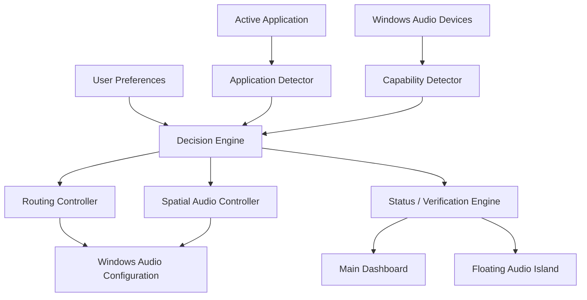

# 🎧 AudioPilot
### Quality-Aware Audio Routing & Real-Time Signal Path Monitor for Windows

> **Working title:** AudioPilot  
> **Platform:** Windows 11  
> **Primary goal:** Automatically choose, configure, explain, and verify the best available audio path **without degrading the audio signal**.

---

## ✨ Project Vision

Modern Windows audio can sound incredible — but getting there is unnecessarily difficult.

A user may have:

- Dolby Atmos-capable speakers or a soundbar
- HDMI audio through an NVIDIA/AMD GPU
- USB DACs
- Bluetooth headphones
- stereo speakers
- multiple streaming apps
- multiple audio formats
- different Windows spatial-audio modes

Yet Windows usually expects the user to manually understand:

- which output device is active
- whether Atmos is enabled
- whether the app supports Atmos
- whether the current content is stereo, lossless, or spatial
- whether the TV is limiting HDMI capabilities
- whether Windows is resampling audio
- whether Bluetooth is reducing quality
- whether the current route is actually the best one

**AudioPilot aims to remove that complexity.**

Instead of asking users to understand WASAPI, EDID, PCM, E-AC-3, spatial audio, passthrough, sample rates, bit depths, or endpoint capabilities, AudioPilot should present a simple answer:

> **Best available audio path active ✓**

while still allowing enthusiasts to inspect the complete signal chain.

---

# 🧠 Core Idea

AudioPilot should primarily be a **control plane**, not an audio processor.

The ideal signal path remains:

```text
Application
    ↓
Windows Audio Stack
    ↓
GPU / USB / HDMI / DAC Driver
    ↓
Playback Device
```

AudioPilot sits **beside** the stream:

```text
                    ┌──────────────────────┐
                    │      AudioPilot      │
                    │                      │
                    │ Detect   Configure   │
                    │ Verify   Explain     │
                    └──────────┬───────────┘
                               │
        ┌──────────────────────┼─────────────────────┐
        ↓                      ↓                     ↓
   Application           Windows Audio          Hardware
   Detection             Configuration          Capabilities
```

AudioPilot should **avoid** this architecture by default:

```text
Application
    ↓
Virtual Audio Device
    ↓
AudioPilot DSP / Mixer
    ↓
Resampling / Re-encoding
    ↓
Playback Device
```

Why?

Because intercepting the audio stream can:

- introduce resampling
- affect bit-perfect playback
- break passthrough
- interfere with Dolby Atmos / DTS:X
- add latency
- complicate DRM-protected playback
- create new failure points

The default philosophy is therefore:

> **Control the audio path without becoming part of the audio path.**

---

# 🎯 Primary Goals

AudioPilot should eventually be able to:

- detect active playback applications
- detect available playback devices
- identify the currently selected output
- inspect endpoint capabilities
- detect HDMI / USB / Bluetooth / built-in audio
- inspect channel configuration
- inspect sample rate and bit depth where available
- detect Windows spatial-audio state
- identify applications with known Atmos / surround capabilities
- automatically route selected applications
- automatically switch between user-defined profiles
- explain why a better playback mode is or is not available
- restore previous Windows audio settings safely
- provide a persistent visual status overlay
- warn when audio quality is unnecessarily degraded

---

# 🚫 Non-Goals — At Least Initially

AudioPilot V1 should **not** attempt to:

- decode Dolby Atmos
- decode DTS:X
- replace Dolby Access
- replace the Windows audio engine
- become a virtual mixer
- apply EQ or DSP
- re-encode protected audio
- inspect DRM-protected stream payloads
- claim a format is active when it cannot be verified
- bypass content or service restrictions

These may be explored later, but they are not necessary for the original problem.

---

# 🪟 User Experience

## 1. Main Dashboard

The main application should give a user both a simple status and an optional technical view.

Example:

```text
┌──────────────────────────────────────────────────────┐
│                    AUDIO STATUS                      │
│                                                      │
│  Apple Music                                         │
│  Dolby Atmos                                         │
│                                                      │
│  Legion → NVIDIA HDMI → Sony HT-A9                   │
│                                                      │
│  ✓ HDMI output                                       │
│  ✓ Atmos-capable endpoint                            │
│  ✓ Dolby Atmos for Home Theater                      │
│  ✓ Correct playback device                           │
│  ✓ No Bluetooth compression                          │
│                                                      │
│             BEST AVAILABLE PATH ACTIVE ✓             │
└──────────────────────────────────────────────────────┘
```

---

# 🏝️ Persistent Floating Audio Island

A major UI feature will be a small **always-on-top floating status pill** inspired by the interaction concept of Apple's Dynamic Island, while using an original visual identity.

The user should be able to enable or disable it.

### Collapsed

```text
┌────────────────────────────┐
│ Dolby Atmos • HT-A9      ✓ │
└────────────────────────────┘
```

### Expanded

```text
┌──────────────────────────────────────┐
│ Apple Music                          │
│                                      │
│ Dolby Atmos                          │
│ Legion → NVIDIA HDMI → Sony HT-A9   │
│                                      │
│ ✓ Atmos active                       │
│ ✓ Correct output                     │
│ ✓ HDMI                               │
│ ✓ No quality warning                 │
│                                      │
│ Volume 42%          [Open Dashboard] │
└──────────────────────────────────────┘
```

### Warning State

```text
┌─────────────────────────────┐
│ ⚠ Stereo PCM • TV Output   │
└─────────────────────────────┘
```

Expanded:

```text
Expected:
Dolby Atmos → Sony HT-A9

Current:
Stereo PCM → TV

Possible reason:
The PC is connected to the TV instead of the HT-A9.

[ Fix Automatically ]
```

---

# 🎛️ Overlay Behaviour

The floating status pill should eventually support:

- always visible
- appear only while audio is playing
- appear only when audio state changes
- auto-hide after a configurable delay
- top-center position
- top-right position
- bottom-right position
- draggable custom position
- compact mode
- detailed mode
- optional click-through mode
- hover-to-expand
- click-to-expand
- warning animation when quality drops
- profile change notifications

---

# 🔊 Example Playback Profiles

## Music

```text
Apple Music
    ↓
Dolby Atmos OR Lossless Stereo
    ↓
NVIDIA HDMI
    ↓
Sony HT-A9
```

Possible policy:

```text
Prefer Immersive:
Dolby Atmos > Lossless Stereo

Prefer Fidelity:
Lossless Stereo > Dolby Atmos
```

The app should not assume one is objectively superior.

Instead:

| Mode | Priority |
|---|---|
| Immersive | Spatial / surround presentation |
| Fidelity | Highest-quality stereo signal |
| Balanced | Use preferred format per application |
| Manual | Never switch automatically |

---

## Movies

Example:

```text
Netflix
    ↓
Dolby Atmos / 5.1 if supported
    ↓
HDMI
    ↓
Home Theater
```

AudioPilot should check:

- current app
- current output
- endpoint capability
- spatial-audio setting
- known platform limitations
- whether the device is connected over HDMI
- whether the current route is likely preventing Atmos

---

## Gaming

Example:

```text
Game
    ↓
Windows Spatial Audio
    ↓
Dolby Atmos for Home Theater
    ↓
HDMI
    ↓
Home Theater
```

---

## Headphones

Example:

```text
Application
    ↓
USB DAC / Headphones
    ↓
Stereo / Headphone Spatial Mode
```

---

# 🔍 Signal Path Inspector

A central feature should be a live signal-path visualization.

Example:

```text
APPLE MUSIC
     ↓
Dolby Atmos Track
     ↓
Windows Spatial Audio
     ↓
NVIDIA High Definition Audio
     ↓
HDMI
     ↓
Sony HT-A9
```

Detailed status:

```text
SOURCE
Application: Apple Music
Process: AppleMusic.exe

CONTENT
Atmos available: Yes
Lossless stereo available: Yes

WINDOWS
Output endpoint: NVIDIA High Definition Audio
Spatial mode: Dolby Atmos for Home Theater
Shared/Exclusive mode: Shared
Sample rate: 48 kHz

DEVICE
Connection: HDMI
Endpoint: Sony HT-A9
Atmos capable: Yes

STATUS
✓ Route valid
✓ Spatial mode valid
✓ Endpoint capable
✓ No Bluetooth compression
```

---

# 🧩 Smart Decision Engine

AudioPilot should contain a rules engine.

Example:

```text
IF
    application == Apple Music
AND
    HT-A9 is connected
AND
    user preference == Immersive
THEN
    route Apple Music → HT-A9
    enable Dolby Atmos for Home Theater
    verify output
```

Another example:

```text
IF
    application == Netflix
AND
    current output == TV
AND
    HT-A9 is available
AND
    TV endpoint reports stereo only
THEN
    warn user
    suggest direct HDMI route
```

---

# 🧠 Explainability

AudioPilot should never simply say:

> "Atmos unavailable."

It should try to explain **why**.

Example:

```text
⚠ DOLBY ATMOS NOT ACTIVE

Netflix supports Atmos.
Your Sony HT-A9 supports Atmos.
Your GPU HDMI output supports multichannel audio.

However:

Current output:
LG TV

Reported endpoint:
2-channel PCM

Possible solution:
Connect the PC directly to the HT-A9 HDMI input.

[ Fix Routing ]
```

This is a major product differentiator.

---

# 🧱 Proposed Technology Stack

## Recommended

```text
Language:
C#

Runtime:
.NET

UI:
WinUI 3
or
WPF for an easier first prototype

Windows Audio:
Core Audio APIs
WASAPI
COM APIs

State:
SQLite or JSON

Installer:
MSIX / WiX / standard Windows installer

Logging:
Serilog or equivalent
```

### Why C#?

The project is deeply tied to Windows:

- audio endpoints
- COM
- WASAPI
- process detection
- native windows
- system tray integration
- always-on-top overlays
- startup tasks
- device notifications

Using C# avoids adding unnecessary complexity.

---

# 🧬 High-Level Architecture



---

# 🪜 Suggested Internal Modules

```text
AudioPilot/
│
├── AudioPilot.App/
│   ├── Dashboard/
│   ├── Overlay/
│   ├── Settings/
│   └── Tray/
│
├── AudioPilot.Core/
│   ├── Models/
│   ├── Profiles/
│   ├── Rules/
│   └── DecisionEngine/
│
├── AudioPilot.WindowsAudio/
│   ├── Devices/
│   ├── Sessions/
│   ├── Routing/
│   ├── SpatialAudio/
│   └── Capabilities/
│
├── AudioPilot.Diagnostics/
│   ├── SignalPath/
│   ├── Verification/
│   └── Logging/
│
├── AudioPilot.Tests/
│
└── docs/
```

---

# 🔬 Windows Audio APIs to Investigate

The first research phase should focus on:

### WASAPI

Used for:

- audio endpoint access
- shared/exclusive mode information
- supported format testing
- audio session interaction

### Windows Core Audio APIs

Useful interfaces include concepts around:

- endpoint enumeration
- device notifications
- session management
- volume controls
- endpoint state

### COM

Some audio control functionality is exposed through COM.

Important:

> Some Windows audio-routing functionality may depend on APIs that are undocumented or behave differently between Windows versions.

Therefore all routing actions must be tested carefully.

---

# 🖥️ Hardware Capability Detection

AudioPilot should eventually understand:

```text
Device
├── Connection type
│   ├── HDMI
│   ├── DisplayPort
│   ├── USB
│   ├── Bluetooth
│   └── Built-in
│
├── Channel support
├── Supported sample rates
├── Supported bit depths
├── Spatial-audio capability
└── Device name / endpoint metadata
```

Later versions may investigate:

- EDID
- HDMI audio capability reporting
- receiver / TV capability chains
- hot-plug events
- GPU audio-driver behaviour

---

# 🔐 Protected Content / DRM Limitations

Streaming services may prevent deep inspection of their protected media streams.

AudioPilot should therefore distinguish between:

### Verified

Information directly reported by Windows or the audio endpoint.

### Inferred

Information based on:

- application
- endpoint capability
- known service support
- current Windows audio settings

### Unknown

Information that cannot be safely determined.

The UI should clearly represent this.

Example:

```text
Dolby Atmos support:       ✓ Verified
HDMI endpoint capability:  ✓ Verified
Current movie codec:       ? Protected / unavailable
Likely playback mode:      Atmos-capable
```

Never fabricate certainty.

---

# 🛡️ Non-Destructive Design

This is a critical requirement.

Before AudioPilot changes anything, it should save the previous state.

Example:

```text
BEFORE

Default device:
Laptop Speakers

Spatial mode:
Off
```

AudioPilot changes:

```text
Default device:
Sony HT-A9

Spatial mode:
Dolby Atmos for Home Theater
```

If the user exits, the app crashes, or an operation fails:

```text
RESTORE

Default device:
Laptop Speakers

Spatial mode:
Off
```

---

# ♻️ Rollback System

Every automatic action should ideally be reversible.

Possible structure:

```text
AudioConfigurationSnapshot
{
    DefaultOutputDevice
    PerAppRoutes
    SpatialAudioMode
    Volume
    MuteState
    Timestamp
}
```

Before making a change:

```text
Create Snapshot
      ↓
Apply Change
      ↓
Verify
      ↓
Success?
   /       \
 Yes       No
  ↓         ↓
Keep      Roll Back
```

---

# 🧪 Safe Development Strategy

## Use a Windows VM for early testing

A VM is ideal for:

- UI development
- overlay development
- process detection
- routing logic
- rules engine
- settings storage
- crash recovery
- installer testing
- registry testing
- startup behaviour
- device-disconnection simulations

Take snapshots frequently.

Example:

```text
Clean Windows VM
      ↓
Install development build
      ↓
Create snapshot
      ↓
Run potentially destructive test
      ↓
Problem?
      ↓
Restore snapshot
```

---

# ⚠️ VM Limitation

A VM will usually expose a **virtual audio device**, not the real:

```text
NVIDIA HDMI
      ↓
Sony HT-A9
```

Therefore a VM is **not sufficient** for final validation of:

- Dolby Atmos for Home Theater
- actual HDMI audio capabilities
- EDID
- receiver detection
- bitstream behaviour
- spatial audio
- HDMI hot-plug
- real sample-rate support
- HT-A9 behaviour

---

# 🧪 Hardware-in-the-Loop Testing

Final validation should happen on real hardware.

Example development system:

```text
Windows 11 PC
      ↓
NVIDIA HDMI Audio
      ↓
Sony HT-A9
      ↓
Television
```

Use real hardware only after the feature passes VM testing.

---

# 🛠️ Development Workflow

```text
Feature Branch
      ↓
Unit Tests
      ↓
Windows VM
      ↓
Snapshot / rollback test
      ↓
Real Windows PC
      ↓
Real audio hardware
      ↓
Validation
      ↓
Merge
```

---

# 🗺️ Development Roadmap

## Phase 0 — Research

Goal: understand Windows audio architecture.

Research:

- WASAPI
- Core Audio
- audio endpoint enumeration
- audio sessions
- per-application routing
- spatial audio APIs
- device capability detection
- Windows audio policies
- shared vs exclusive mode
- HDMI capability reporting

Deliverable:

```text
docs/windows-audio-research.md
```

---

## Phase 1 — Device Inspector

Build a console application first.

It should print:

```text
Detected Devices:

1. Speakers
   Connection: Internal
   Channels: Stereo

2. NVIDIA High Definition Audio
   Connection: HDMI
   Device: Sony HT-A9
   Channels: Multichannel
```

Do not change anything yet.

---

## Phase 2 — Audio Session Monitor

Detect currently active applications.

Example:

```text
ACTIVE AUDIO

AppleMusic.exe
Volume: 65%

Discord.exe
Volume: 20%

Chrome.exe
Inactive
```

---

## Phase 3 — Main GUI

Create:

- device cards
- active-app cards
- signal-path visualization
- warnings
- profile selector

---

## Phase 4 — Floating Audio Island

Implement:

- borderless window
- transparency
- always-on-top
- compact state
- expanded state
- animations
- click-through option
- position preferences

---

## Phase 5 — Manual Routing

Allow the user to select:

```text
Apple Music → Sony HT-A9
Discord → Headphones
Chrome → Speakers
```

Still no automation.

---

## Phase 6 — Profiles

Example:

```text
MOVIE MODE

Output:
Sony HT-A9

Spatial:
Dolby Atmos for Home Theater

Preferred apps:
Netflix
VLC
Kodi
```

---

## Phase 7 — Automatic Routing

Add rule-based switching.

Example:

```text
Netflix starts
      ↓
Movie profile activates
      ↓
HT-A9 selected
      ↓
Audio state verified
      ↓
Overlay:
"Movie Mode • Atmos Ready ✓"
```

---

## Phase 8 — Quality Verification

Detect likely problems such as:

- Bluetooth being used instead of HDMI
- stereo endpoint selected
- incompatible spatial mode
- unexpected sample rate
- wrong playback device
- receiver disconnected
- TV limiting the route

---

## Phase 9 — Smart Recommendations

Example:

```text
Current:
Bluetooth Headphones
AAC

Available:
USB DAC
24-bit / 96 kHz

Suggestion:
Switch to USB DAC for higher-fidelity playback.

[ Switch ]
```

---

# 🧰 MVP Definition

The first truly useful version does **not** need Atmos decoding.

MVP:

- [ ] enumerate Windows playback devices
- [ ] detect active audio applications
- [ ] display current output
- [ ] manually route an application
- [ ] save application routing rules
- [ ] restore previous settings
- [ ] persistent tray icon
- [ ] floating status pill
- [ ] signal-path visualization
- [ ] quality warnings
- [ ] VM-safe testing
- [ ] real-hardware validation

---

# 🌱 Future Features

Possible later additions:

- automatic HDMI capability analysis
- Bluetooth codec awareness
- USB DAC awareness
- external DAC recommendations
- per-device preferred sample rates
- AV receiver profiles
- TV passthrough detection
- app-specific presets
- home-theater mode
- headphone mode
- gaming mode
- music mode
- movie mode
- notifications when playback quality drops
- optional remote/mobile companion app
- community-maintained device capability database

---

# 📊 Example Quality Status Model

Instead of one vague quality score, AudioPilot should report separate dimensions.

```text
IMMERSION
★★★★★
Dolby Atmos available

SIGNAL FIDELITY
★★★★☆
High-quality stream

ROUTING
★★★★★
Direct HDMI

DEVICE CAPABILITY
★★★★★
Atmos-capable endpoint

CONFIDENCE
★★★★☆
Codec payload protected by DRM
```

For the actual product UI, avoid presenting a single "best" score when multiple trade-offs exist.

---

# 🧭 User Preference Modes

A user may prefer different things.

### Immersive

Prioritize:

- Dolby Atmos
- multichannel playback
- spatial sound

### Fidelity

Prioritize:

- lossless stereo
- high bit depth
- high sample rate
- minimal processing

### Gaming

Prioritize:

- low latency
- spatial positioning
- stable device routing

### Automatic

Use app-aware policies.

---

# 🧪 Example Test Cases

### Test 1 — HT-A9 Connected

```text
Given:
HT-A9 connected by HDMI

When:
Apple Music starts

Then:
AudioPilot detects HT-A9
Displays Atmos capability
Shows current route
```

---

### Test 2 — Wrong Output

```text
Given:
HT-A9 is connected

When:
Windows outputs to laptop speakers

Then:
AudioPilot warns:
"Home theater available but not selected."
```

---

### Test 3 — Device Disconnected

```text
Given:
Apple Music routed to HT-A9

When:
HT-A9 disconnects

Then:
AudioPilot falls back safely
Updates overlay
Does not crash
```

---

### Test 4 — Application Exit

```text
Given:
Movie profile is active

When:
Netflix closes

Then:
Previous audio profile is restored
```

---

# 🔭 Research Angle

This project can also be framed as a research problem.

Possible topic:

> **Quality-Aware Automatic Audio Routing and Configuration for Heterogeneous Windows Playback Devices**

Possible research question:

> Can a Windows application automatically select, configure, and verify the highest-quality available playback path using application context, device capabilities, operating-system state, and user preferences without intercepting or modifying the audio stream?

Potential evaluation metrics:

- successful route-selection rate
- incorrect-route detection rate
- configuration time saved
- number of user interactions required
- rollback reliability
- device detection accuracy
- perceived usability
- expert vs non-expert success rate

---

# 🔎 Existing Software to Study

AudioPilot should learn from existing utilities without becoming a clone.

Areas worth studying:

### EarTrumpet

Useful ideas:

- improved Windows mixer
- per-application control
- polished Windows UX

### SoundSwitch

Useful ideas:

- device switching
- profiles
- application-triggered behaviour

### Other routing utilities

Useful ideas:

- rules engines
- per-app assignments
- persistent routing

The differentiation for AudioPilot should be:

> **Quality-aware routing + capability detection + verification + explanation + persistent signal-path UI.**

---

# 🧠 Core Product Principle

A normal user should never need to know what this means:

```text
E-AC-3 JOC
WASAPI
EDID
LPCM
Exclusive Mode
HDMI Endpoint
Spatial Audio
```

They should see:

```text
Best available audio path active ✓
```

And an enthusiast should be able to expand it and see everything.

---

# ✅ First Session Checklist

When starting development:

- [ ] Install Visual Studio 2022/2026
- [ ] Install .NET desktop development workload
- [ ] Create Git repository
- [ ] Create clean Windows VM
- [ ] Enable VM snapshots
- [ ] Create solution structure
- [ ] Create `AudioPilot.WindowsAudio`
- [ ] Enumerate playback devices
- [ ] Print device names to console
- [ ] Detect active audio sessions
- [ ] Commit first working prototype

The **first milestone** is deliberately simple:

> **List every Windows playback device and every application currently producing audio.**

Do not build automatic routing until this works reliably.

---

# 📌 Project Rules

1. **Never degrade audio silently.**
2. **Never claim a format is active unless it is verified or clearly marked as inferred.**
3. **Every automatic configuration change must be reversible.**
4. **Do not intercept audio unless a future feature absolutely requires it.**
5. **Prefer native Windows APIs over virtual devices.**
6. **Test potentially destructive changes in a VM first.**
7. **Validate real audio behaviour on physical hardware.**
8. **Design for normal users first, enthusiasts second.**
9. **Explain problems instead of merely reporting them.**
10. **Keep the signal path visible and understandable.**

---

# 🚀 Immediate Next Step

Start with a tiny console prototype:

```text
AudioPilot Device Inspector v0.0.1

PLAYBACK DEVICES
----------------

[1] Speakers
    State: Active

[2] NVIDIA High Definition Audio
    State: Active

ACTIVE AUDIO SESSIONS
---------------------

AppleMusic.exe
Discord.exe
```

Once this works, the project has its first real foundation.

From there:

```text
Device Detection
      ↓
Session Detection
      ↓
Signal Path UI
      ↓
Manual Routing
      ↓
Profiles
      ↓
Automatic Routing
      ↓
Quality Verification
```

---

## Status

**Project stage:** Planning / Research  
**Version:** `0.0.1-concept`  
**Primary platform:** Windows 11  
**Architecture principle:** Non-destructive, quality-preserving audio orchestration
