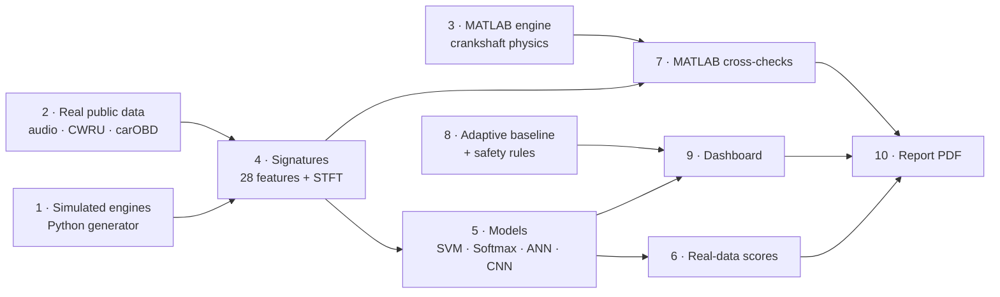

# AutoPulse walkthrough: every step, and how we use it

AutoPulse turns engine sound, vibration and OBD-II telemetry into **signatures**, recognises faults with **four model families**, learns **each car's own normal**, and tells the driver **what to do**. The pipeline below runs end to end on one laptop. Each step lists what it does, how to run it, what it produces, and **how we use it**.



> All numbers below are from our latest runs (October 2026) and are read from `models/*.json`.

---

## 0 · Setup (once per laptop)

```bash
python -m venv .venv
.venv\Scripts\python -m pip install -r requirements.txt --extra-index-url https://download.pytorch.org/whl/cpu
```

**How we use it:** every teammate gets the same pinned package versions, so results reproduce.

---

## 1 · Simulated engines: `autopulse/generator.py`

**What it does:** builds 1-second engine-block vibration windows from crank kinematics. A 4-cylinder engine fires every 180°, and each event (combustion, knock, valve impact, bearing defect) excites the block's resonances. Seven conditions: healthy, misfire, knock, valve wear, bearing, belt squeal, imbalance. Ten different simulated cars, each with its own resonances and geometry.

**Run:** used automatically by `train.py`. To see the signatures: `.venv\Scripts\python scripts\checks\smoke_test.py`

**How we use it:** for every fault on demand, with perfect labels, and the long ageing and seasonal histories that no public dataset has. These feed model pre-training (step 5) and the adaptive-baseline study (step 8).

---

## 2 · Real public data: `scripts/download_data.py`

**What it does:** downloads four free, no-login datasets into `data/raw/` (about 550 MB, not committed to git).

| Dataset | What it is | How we use it |
|---|---|---|
| Engine audio (Hugging Face) | 321 real engine recordings, 48 kHz: healthy, misfire, tappet, belt | Main real test of the fault classifiers |
| CWRU bearings | Real vibration, normal + 3 bearing faults, 4 motor loads | Real test of the vibration signatures |
| carOBD | 129 real OBD-II trips (Toyota Etios, 1 Hz) | Real test of the adaptive baseline; realistic drive cycles |
| Engine condition table | 19.5k telemetry rows, good/faulty | Checked, then rejected as a benchmark (labels don't track sensors) |

**Run:** `.venv\Scripts\python -I scripts\download_data.py`

**How we use it:** every score we report as a result comes from these real recordings, never from the simulator. Login-gated sets (UFPB acoustic on IEEE DataPort) are deliberately left out.

---

## 3 · MATLAB engine simulation: `matlab/crank_sim.m`

**What it does:** a second, independent engine simulator in MATLAB. It solves the crankshaft's equation of motion, `J·dω/dt = Σ gas torque − load torque`, for a 4-cylinder engine (firing order 1-3-4-2), with misfires injected on any cylinder at full or half severity. It records crank speed the way a 60-2 tooth wheel would.

**Run:** in MATLAB, `cd matlab` then `crank_sim`, or from a terminal:

```bash
matlab -batch "cd matlab; crank_sim"
```

**Produces:** `matlab/out/crank_runs.csv`: 84 runs at 800–3,500 rpm, 10,798 firing events.

**How we use it:** it's the brief's "MATLAB engine simulation" data source, and it tests the misfire detector on physics it was never built from (step 7).

---

## 4 · Signature extraction: `autopulse/signatures.py`

**What it does:** turns each window into 28 numbers plus one image:

| Domain | Features | Reveals |
|---|---|---|
| Time | RMS, crest factor, kurtosis, skewness, zero-crossing rate | Impacts, overall level |
| Frequency (FFT) | 10 band energies, spectral centroid, flatness | Knock band, belt squeal, resonances |
| Engine orders | Amplitude at 0.5×, 1×, 1.5×, 2×, 3×, 4× crank speed | Misfire (0.5×), imbalance (1×), firing (2×) |
| Envelope (Hilbert) | Impact repetition rate and prominence | Bearings, valve tick |
| Knock band | Kurtosis of the 5.5–8 kHz band | Detonation |
| Crank speed | Irregularity, deepest dip | Misfire per cylinder |
| Time-frequency | 64 × 95 STFT spectrogram | CNN input |

For real audio there is no tachometer, so engine speed is **estimated from the sound itself**: the sound's envelope repeats at the firing frequency.

**How we use it:** these are the signatures the brief asks for. Every model and the adaptive baseline work on them, and they make every alert explainable ("energy rose in the knock band").

---

## 5 · Train the models: `train.py`

**What it does:** trains SVM, Softmax regression, ANN (MLP) and a CNN, the four families the brief names, on simulated engines. It tests on two engines held out of training.

**Run:** `.venv\Scripts\python train.py` (about 1 minute)

**Produces:** `models/*.joblib`, `models/cnn.pt`, `models/metrics.json`

**Result on held-out simulated engines:** SVM 98.3% · ANN 97.9% · Softmax 97.4% · CNN 74.0%

**How we use it:** these models power the dashboard's live verdicts. The simulator scores are upper bounds; step 6 gives the honest numbers.

---

## 6 · Real-data train/test: `evaluate_real.py`

**What it does:** retrains and tests every model on real recordings, with splits that can't leak:

| Real test | Split | Best result |
|---|---|---|
| Engine sound, 4 classes | 5 folds, grouped by recording | **SVM 90.3%** of windows, **91.0%** of whole recordings |
| Bearing vibration (CWRU), 4 classes | Train on 3 motor loads, test on the 4th | 100% (a known easy benchmark) |
| carOBD adaptive baseline | Learn / calibrate / test on separate trips | False alarms on **14%** of healthy trips vs 31% for a fixed baseline; **91%** of vacuum leaks and **80%** of weak-charging faults caught |
| Engine-condition table | Stratified 5 folds | 66% vs 63% for guessing; rejected |

Models trained **only** on the simulator reach macro F1 0.39 at best on real audio. That is the sim-to-real gap round 2 will close.

**Run:** `.venv\Scripts\python evaluate_real.py` (about 15 minutes; `audio`, `cwru`, `condition` or `obd` runs one part)

**Produces:** `models/real_metrics.json`

**How we use it:** these are the numbers we present as results, and the dashboard's Models tab and the report read them straight from this file.

---

## 7 · MATLAB cross-checks: `scripts/matlab_crosscheck.py`

**7a · Misfire detection on MATLAB's engine.** A detector trained only on our Python simulator is tested on the MATLAB crankshaft data. The misfiring cylinder is also named from crank physics alone (the cylinder whose power stroke adds the least speed).

```bash
.venv\Scripts\python scripts\matlab_crosscheck.py crank
```

**Result:** misfire detection **100%** (84/84 runs). Cylinder named correctly **100%** at 800, 1,500, 2,500 and 3,500 rpm.

**7b · MathWorks' own engine, in Simulink.** We run MathWorks' "Detect Misfires Using On-Board Diagnostics" example (Simulink + Powertrain Blockset + AUTOSAR Blockset; model `autoblkSICoreOBDMisfire`), which injects misfires on cylinder 3. Our crank-speed detector runs **blind**: it cuts the crank angle into 180° power strokes and flags any stroke whose speed gain falls more than 4 robust standard deviations below normal. The model's misfire flag is used only for grading.

```bash
matlab -batch "cd matlab; run_mw_misfire; export_mw_misfire"
.venv\Scripts\python scripts\matlab_crosscheck.py mathworks
```

**Result:** **11 of 11** injected misfires detected, 2 false alarms in 71 healthy power strokes. A misfiring stroke loses about 23 rpm where a healthy one gains about 1. Nine of the 11 are pinned to cylinder 3's slot; the other two straddle a slot boundary.

**7c · Our signal processing, re-done in MATLAB.** 60 real engine-audio windows are exported, MATLAB recomputes **all 28 features** (the filters with Signal Processing Toolbox), and Python compares them.

```bash
.venv\Scripts\python scripts\matlab_crosscheck.py export
matlab -batch "cd matlab; signature_check"
.venv\Scripts\python scripts\matlab_crosscheck.py dsp
```

**Result:** 23 features agree to within **6 × 10⁻¹⁴** (floating-point noise). The 3 filter features (envelope peak, envelope prominence, knock-band kurtosis) match on every window, to within about 0.002%; the only difference is how each tool pads the signal edges. The 2 crank features agree to 4 × 10⁻¹² on MATLAB's crank simulation.

**How we use it:** three independent engines (our Python generator, our MATLAB physics, and MathWorks' Simulink model) all show the same misfire signature, and every number our DSP produces is confirmed in industry-standard MATLAB. Results land in `models/matlab_crosscheck.json`.

---

## 8 · Adaptive baseline and safety rules: `autopulse/baseline.py`, `autopulse/rules.py`

**What it does:**
- **Adaptive baseline:** learns normal **per car and per context** (cold start vs warm idle, load band). It learns slowly, only from healthy-looking data, and freezes while an anomaly is open. Slow ageing becomes a health % bar; sudden change becomes an alert.
- **Safety rules:** hard limits that never adapt (puncture, oil pressure, overheating, charging, belt, fuel leak, CO). Each comes with instructions: AC off and heater max, minutes of battery left, the nearest mechanic.

**Results:** over 8 simulated months, a fixed baseline raised alarms on 74 days before any fault existed; the adaptive one on 0, and it caught the real fault in 3 days. On real carOBD trips: see step 6.

**How we use it:** decides when the dashboard shows "normal ageing" and when it shows "something changed, here's what to do".

---

## 9 · The app: `run.bat` → `backend/` + `frontend/`

**What it does:** a Python API (`backend/app.py`, FastAPI) serves the same simulators, signatures, models, baseline and safety rules as JSON. A React app (`frontend/`, Vite + three.js) is the screen on top. Nothing about the science changed in the move from Streamlit; the Streamlit app (`app.py`) still runs as a fallback.

**Run:** double-click `run.bat`. It checks Python and Node, creates `.venv`, installs dependencies only when `requirements.txt` or `package.json` change, trains the models if missing, checks the ports, starts the API (port 8000) and the UI (port 5173) and opens the browser. Ctrl+C stops both.

| Screen | Shows | How we use it |
|---|---|---|
| Garage | Pick hatchback, sedan, SUV, pickup or coupe; a see-through wireframe model with its health score and what needs attention | Opening demo: the user meets *their* car |
| Health check | Animated key-on scan; click a check and the car turns to that part, with the sensors and method explained | Shows every subsystem being checked |
| Live drive | 1 Hz OBD telemetry with a scrubber, one chart per tab, and the safety rules' guidance | Shows the hard limits acting |
| Signatures | Waveform, spectrum, spectrogram, envelope, orders, crank speed; four models' votes; compare car types | Signature extraction, the brief's core |
| Insights | Adaptive vs fixed baseline over 8 months; component wear | "Normal is personal" and wear prediction |
| Evidence | Real-data, MATLAB and Simulink, and simulator results | The proof |

Scenario controls (engine fault, severity, vehicle fault, ambient, unit) live in the **Scenario** drawer, so the screens stay uncluttered. A URL like `?page=signatures&engine=knock&car=suv` opens a screen with a preset scenario.

**The car models:** `blender/build_cars.py` builds each car procedurally in Blender (lofted body with real cross-sections, glass, lights, mirrors, tyres with spoked rims). It exports the wireframe as designed line geometry: cross-section rings and front-to-back contour lines, window outlines and tyre wire. It also exports named parts (engine, battery, radiator, fuel tank, four tyres) that the app lights up by health status. Rebuild with `blender -b -P blender/build_cars.py -- blender/out` and copy the `.glb` files to `frontend/public/models/`; open `blender/out/*.blend` to tweak a model by hand.

---

## 10 · Report: `report/`

```bash
.venv\Scripts\python report\figures.py
.venv\Scripts\python report\capture.py      # needs the dashboard running
.venv\Scripts\python report\build.py --png all
```

**Produces:** `report/AutoPulse-Concept-Report.pdf`. Its numbers are read from `models/*.json`, never typed by hand.

**How we use it:** the round-1 submission.
